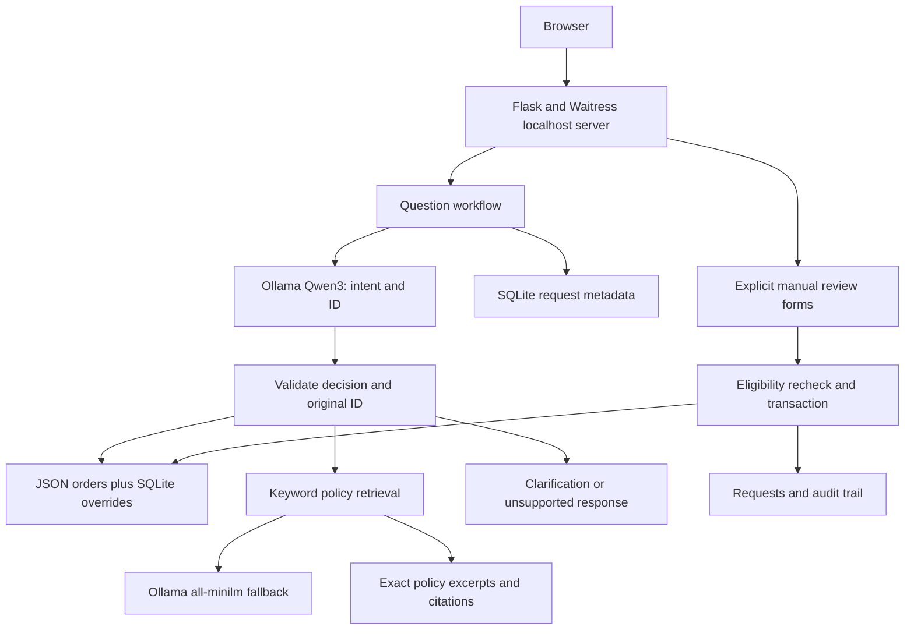

# ResolveAI architecture

A local, single-process support prototype using fictional records. The model routes questions; Python controls data access and manual review updates.

## Request flow

The HTTP form handler validates request size and checks explicit order IDs against the signed-in customer before calling the model. The model returns schema-constrained intent and order ID. Python validates the decision; lookup IDs must occur in the original question. Order responses use record-based templates. Policy retrieval uses keyword overlap first, then cosine ranking when no keyword matches. Score and margin thresholds control semantic abstention. Policy excerpts are copied verbatim, not synthesized.

Question requests receive trace IDs and record status, outcome, tool, retrieval method, and duration. Prompts and answers are excluded from the trace database. HTML output is escaped. Unexpected question-processing exceptions produce a generic response; unexpected route exceptions return generic HTTP 500 responses.

## Manual review

AI cannot change an order. A separate form creates pending requests only for processing orders. SQLite transactions persist decisions, status overrides, and audit events. A unique index deduplicates pending requests. Approval rechecks eligibility, and completed requests cannot be decided twice.

A process-local form token is not authentication. A single local reviewer account gates approval; customer ownership is checked separately. Customer ownership is enforced on browser/API access using fixed fictional mappings. New audit events identify the customer or single reviewer account.

## Persistence and validation

JSON fixtures and evaluation datasets are tracked. Ignored runtime databases persist local reviews and traces. Trace retention is 1,000 records, with the newest 100 displayed; review history has no retention policy yet.

CI uses temporary databases and mocked model calls. Separate live evaluations use local Ollama and save timestamped reports. Order evaluation isolates fixtures from manual cancellations.

## Design limits

- Constrained workflow, without autonomous planning or multiple agents.
- Exact excerpts provide citations but not personalized eligibility decisions.
- Keyword-first search is not weighted hybrid ranking; keyword collisions and semantic false negatives remain possible.
- Three policy sections do not require a vector database. Larger corpora need ingestion, chunking, indexing, and access-aware retrieval.
- Waitress-served Flask application with customer/reviewer sign-in and per-process login limits; shared deployment controls and load validation are unfinished.
- Request-level metrics, without model spans, token counts, or accuracy measurement.

## Delivery status and remaining gates

Implemented locally: customer/reviewer sign-in, fixed order ownership, actor-bearing audit events, Waitress startup, body limits, generic error handling, request tracing, container build/start CI, and a screenshot walkthrough. GitHub CI verifies the application image, not full model inference in Compose.

Before public deployment:

1. HTTPS/Secure cookies, shared session/rate-limit storage, trusted proxy configuration, and authenticated trace access.
2. Operational/load validation, model/database readiness checks, and a deployment/recovery plan.
3. Full Compose model inference verification; current native Mac inference is separately tested.
4. Independent evaluation questions, immutable model provenance, and quality checks beyond tuned examples.

## Sign-in attempt protection

A Flask before-request hook reserves an attempt before credential verification. Separate reviewer/customer endpoint windows use the actual connection IP, with five attempts in 60 seconds. Over-limit responses return 429 and Retry-After. Thread locking prevents parallel attempts from exceeding the budget; expired entries are removed and active storage is bounded. Forwarding headers are ignored. This local single-process implementation needs shared storage and a trusted proxy policy before distributed deployment.
