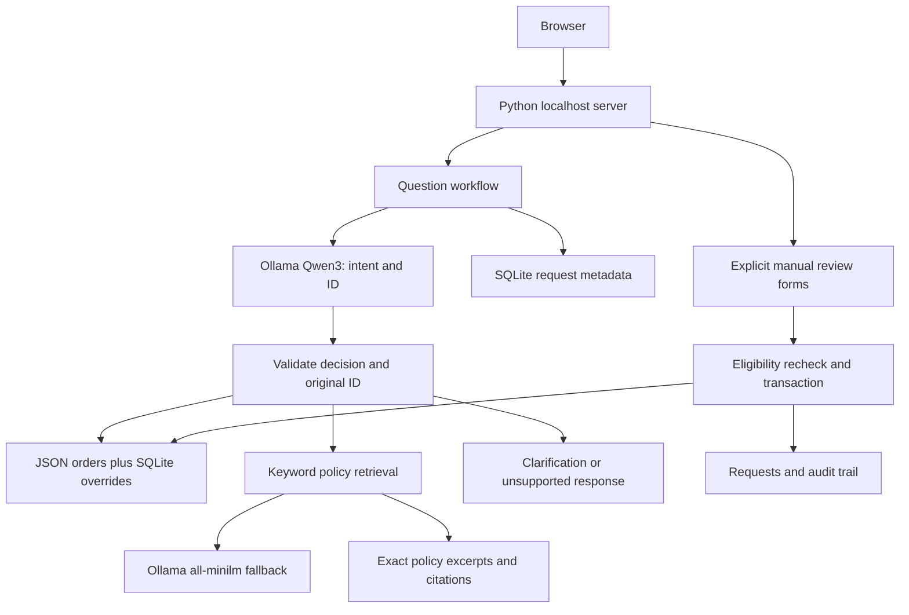

# ResolveAI architecture

A local, single-process support prototype using fictional records. The model routes questions; Python controls data access and manual review updates.

## Request flow

The HTTP form handler validates request size. The model returns schema-constrained intent and order ID. Python validates the decision; lookup IDs must occur in the original question. Order responses use record-based templates. Policy retrieval uses keyword overlap first, then cosine ranking when no keyword matches. Score and margin thresholds control semantic abstention. Policy excerpts are copied verbatim, not synthesized.

Question requests receive trace IDs and record status, outcome, tool, retrieval method, and duration. Prompts and answers are excluded from the trace database. HTML output is escaped. Unexpected question-processing exceptions produce a generic response; review-route failure handling remains incomplete.

## Manual review

AI cannot change an order. A separate form creates pending requests only for processing orders. SQLite transactions persist decisions, status overrides, and audit events. A unique index deduplicates pending requests. Approval rechecks eligibility, and completed requests cannot be decided twice.

A process-local form token is not authentication. Anyone with local access can approve requests. Customer ownership and reviewer identities are not implemented.

## Persistence and validation

JSON fixtures and evaluation datasets are tracked. Ignored runtime databases persist local reviews and traces. Trace retention is 1,000 records, with the newest 100 displayed; review history has no retention policy yet.

CI uses temporary databases and mocked model calls. Separate live evaluations use local Ollama and save timestamped reports. Order evaluation isolates fixtures from manual cancellations.

## Design limits

- Constrained workflow, without autonomous planning or multiple agents.
- Exact excerpts provide citations but not personalized eligibility decisions.
- Keyword-first search is not weighted hybrid ranking; keyword collisions and semantic false negatives remain possible.
- Three policy sections do not require a vector database. Larger corpora need ingestion, chunking, indexing, and access-aware retrieval.
- Development HTTP server, without login, rate limiting, deployment configuration, or load validation.
- Request-level metrics, without model spans, token counts, or accuracy measurement.

## Delivery gates

1. Authenticated customer/reviewer roles, order ownership checks, and reviewer audit identity.
2. Deployment-ready application server, configuration, consistent error handling, request limits, and operational checks.
3. Independent evaluations with paraphrases, negative examples, mixed intents, repeated runs, and category metrics.
4. Reproducible deployment and a walkthrough documenting measured capabilities and limitations.
