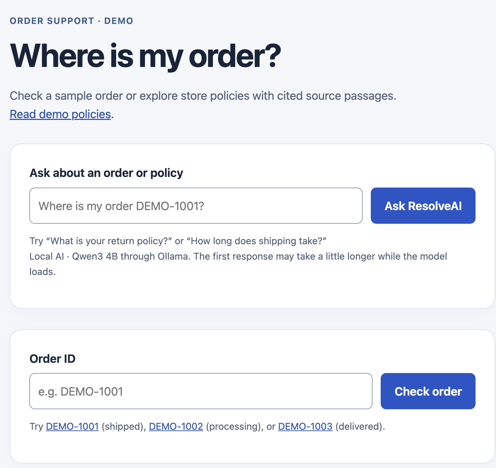
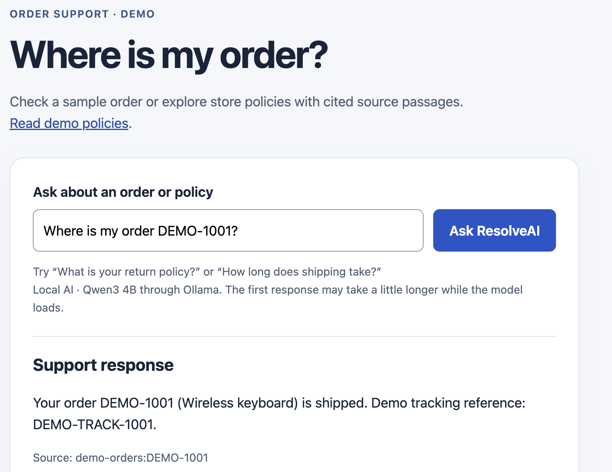
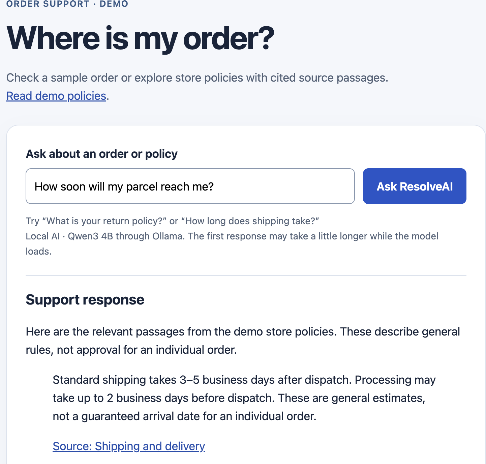
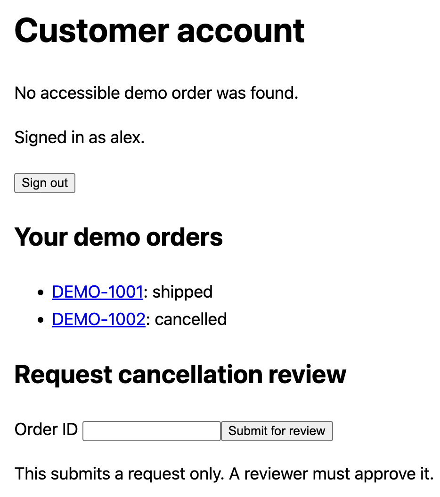
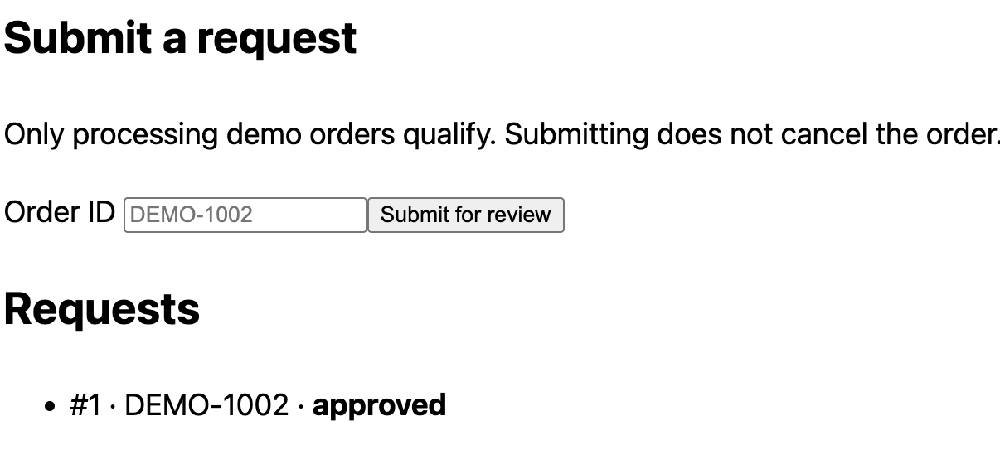
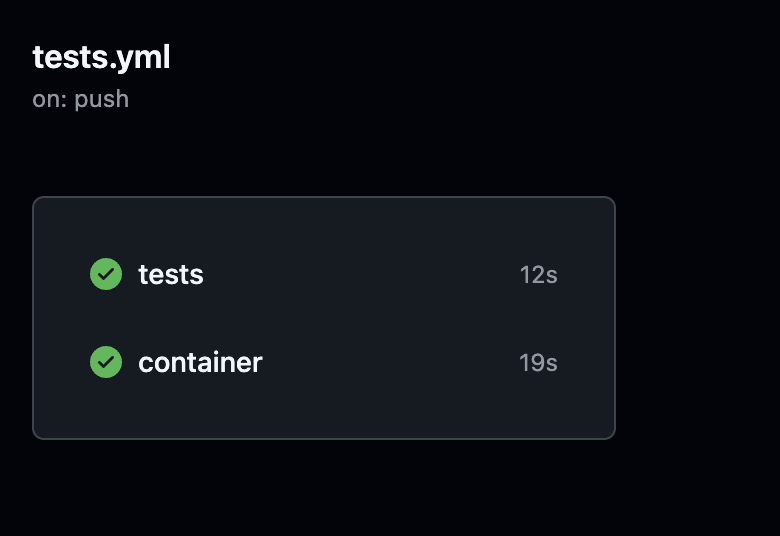

# ResolveAI screenshot walkthrough

A local AI support prototype using fictional orders and store policies. This walkthrough shows the running application without requiring audio, video, or a public deployment. For setup and a repeatable demo, see [DEMO.md](DEMO.md).

These screenshots were captured during local development. Some show an earlier interface; fixed example labels in the first image are illustrative, not live status. The current app shows each signed-in customer's saved order states. The images below are unmodified screenshots, not mockups.

## 1. Ask an order or policy question

The support page provides a natural-language question form and a direct order-ID lookup. General policy questions are public; order details require customer sign-in. Qwen3 runs locally through Ollama.

## 2. Retrieve order facts from records

The customer asks “Where is my order DEMO-1001?” The response identifies the wireless keyboard as shipped and displays its source record reference. The model interprets the request; Python validates access and constructs the answer from saved data.

## 3. Find and cite a policy passage

“How soon will my parcel reach me?” retrieves the shipping policy. The response quotes the passage and links to the source document. The workflow uses keywords first and semantic fallback for unmatched wording; this screenshot demonstrates the cited passage, not the search-method indicator, which is outside the captured area.

## 4. Enforce customer ownership

When Alex attempts to access an inaccessible order, the application returns a generic message and shows only Alex's mapped orders. Signing in identifies the customer; ownership checks separately decide which records the customer may access.

## 5. Review a cancellation request

The review page shows request #1 for DEMO-1002 as approved. Submission alone does not cancel an order. Reviewer approval rechecks eligibility before a transaction updates the fictional order. The application also records audit events, but the audit trail is not included in this screenshot.

## 6. Verify automated checks

GitHub Actions shows successful `tests` and `container` jobs. They verify regression behavior, image build, tests inside the image, and HTTP startup. These checks mock AI calls and do not demonstrate full model inference in Docker. The displayed timings belong to this particular run.

## Evaluation and project scope

The authored challenge set improved from 15/22 to 22/22 in two repeated runs after routing changes. This is a tuned development benchmark, not held-out accuracy. See [challenge evidence](CHALLENGE_RESULTS.md), [architecture](ARCHITECTURE.md), and [container verification limits](CONTAINERS.md).

The prototype includes fictional customer accounts, ownership enforcement, manual cancellation review, request tracing, login attempt limits, and a repeatable local demo. Public hosting and full AI inference inside Docker remain separately unverified. No real orders, refunds, or production customer outcomes are represented here.
